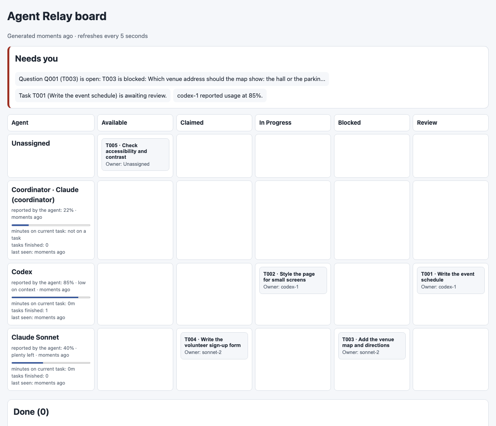

# Agent Relay

**Agent Relay is a local task board for coding agents.** As Chat A nears its usage limit mid-schedule, it records the next step before stopping; Chat B resumes from the project record and submits the edit for review.

Board state lives in the target project's `team/` folder; no hosted service or third-party agent harness is required. Your selected coding agent/tool reads project instructions and skills at `.agents/skills/<name>/SKILL.md`—for software QA, editing, or data validation—and performs the actual work.

## What it does

- Tracks task ownership, progress, dependencies, questions, decisions, and handoffs.
- Reserves files against overlapping claims; task owners cannot approve their own work.
- Includes read-only status and eight portable skills.
- Draws the whole board as one page, `team/BOARD.html`: a lane per agent, who is stale, each agent's reported usage, and a "Needs you" strip for questions, reviews and stalled work.
- Lets one agent join as the coordinator: it is told when something needs attention, can take a task from a stuck agent, and can wait in its chat until something happens. `watch` shows a Mac notification for you.
- Optionally gives each task its own git working copy (`"worktrees": true` in `team/config.json`); approving a task merges it into your branch.


- Uses Python 3.8+ and the standard library; there is nothing to install.

## Choose a model for the job

You control model strength and usage allocation in your coding app. Agent Relay does not route work or meter tokens.

- **Planner:** choose your strongest model for unclear scope or architecture.
- **Worker:** choose a faster, lower-cost model for a bounded edit such as adding two schedule rows.
- **Reviewer or replacement:** choose a different capable model for review. If a worker is nearing its limit, hand off before stopping; you choose the next chat's model and budget.

## Getting started

Clone [ECMSiegel/Agent-Relay](https://github.com/ECMSiegel/Agent-Relay), then open the same Event Page folder in two chats:

```sh
git clone https://github.com/ECMSiegel/Agent-Relay.git
cd "Agent-Relay/examples/Event Page"
```

The starter has two schedule rows and a note that the rest of the program is being finalized. Use Prompt 1 in Chat A; review and approve its plan and tasks. After its first edit, use Prompt 2 in Chat A. Open the same folder in Chat B and use Prompt 3 to resume from the handoff.

If an agent cannot find the kit, point it to `../../.agents/skills/team-init/SKILL.md`.

### Prompt 1 — prepare the task and make the first slice

```text
Set up team coordination here. Goal: finish the accessible Harbor Lights Community Night page. Scope: local, dependency-free edits to index.html only. Success: title, date, venue, and complete schedule are visible in order at narrow and wide widths, with no remote assets.

Create review-required T001 “Complete the event schedule” for index.html. Its complete schedule is: 5:30 PM check-in and harbor welcome; 5:45 PM welcome from the neighborhood; 6:00 PM opening toast; 6:15 PM make-and-share activity; 6:45 PM harbor supper break; 7:00 PM community performances; 7:45 PM closing thanks; 8:00 PM event ends. Create T002 for later visual polish in index.html, dependent on T001. Show the full plan and task proposals; wait for my approval.

After approval, initialize, join, claim, and start T001. Add only the 6:00 PM opening toast and 6:15 PM activity. Leave T001 in progress, the remaining entries for the next worker, and “The rest of the program is being finalized.” in place. Do not hand off yet.
```

### Prompt 2 — leave a recoverable handoff

```text
Hand off T001. Record that index.html has the 5:30, 5:45, 6:00, and 6:15 rows; the 6:45 supper break, 7:00 performances, 7:45 closing thanks, and 8:00 event end remain; and the “rest of the program” note must be removed. End the handoff with `index.html: uncommitted edits`. Run check-exit, leave, and do not edit index.html further.
```

### Prompt 3 — resume and submit for review

```text
Join and follow team/PROTOCOL.md. Claim T001 and read its full handoff. Add the four remaining rows, remove the note, verify all eight rows are visible and ordered, then submit for independent review. Leave visual polish for later.
```

You’ll see **2 → 4 → 8** visible rows. A different agent reviews before approving T001.

## Use an existing project

From an existing project folder, initialize with the kit's full path (replace the placeholder with its local path):

```sh
python3 "/absolute/path/to/Agent-Relay/.agents/team/team.py" init
python3 team/team.py status
```

On a new board, run `init` and then `status`. Initialization preserves project files, existing instructions, and `AGENTS.md`. If `team/` already exists, inspect its status before running `init` again. After setup, use the local `team/team.py` launcher. Status is read-only and does not refresh an agent heartbeat.

## License

MIT License. Copyright (c) 2026 Ethan Siegel. See [LICENSE](LICENSE) for the full terms.
